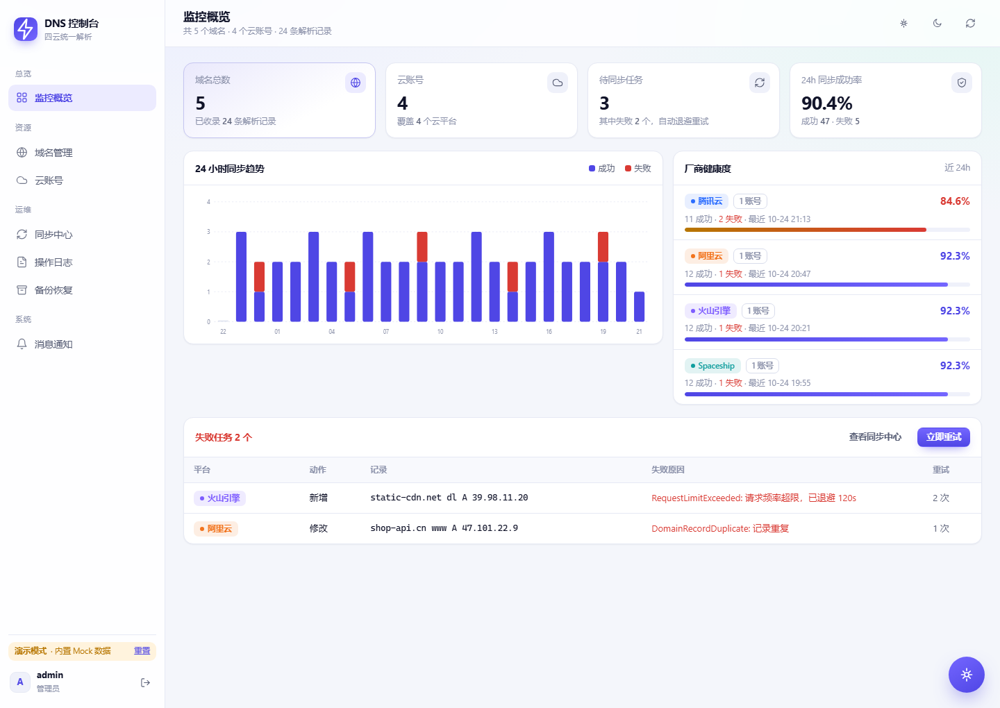
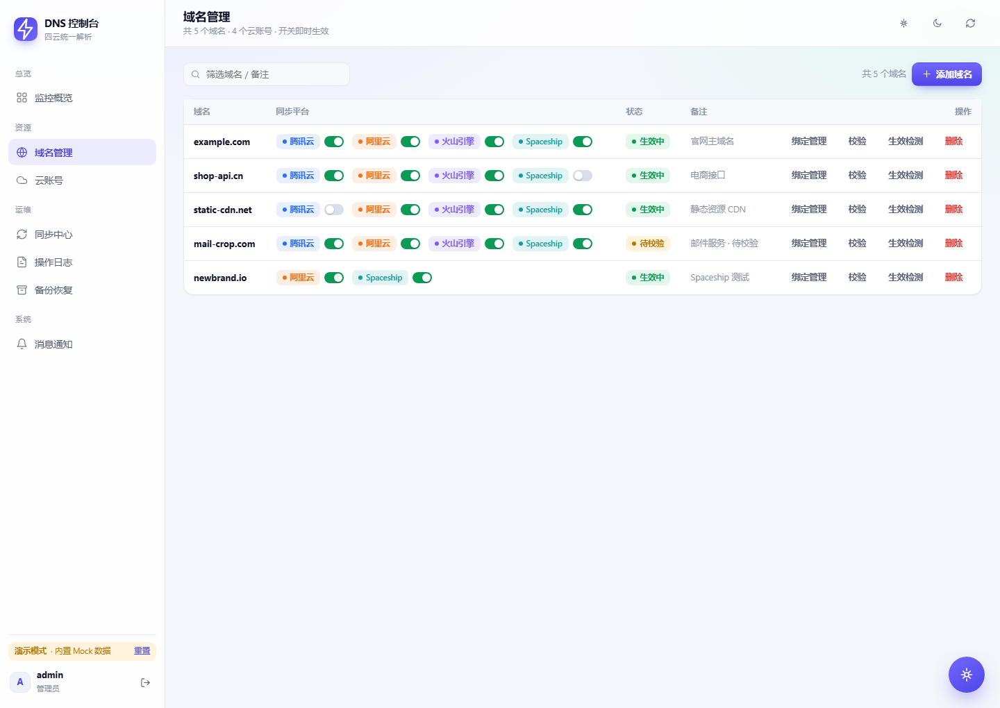
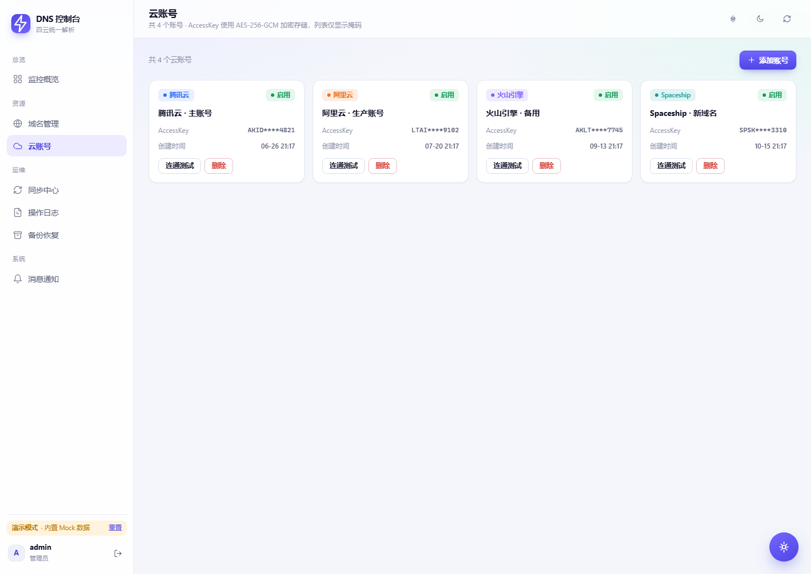

# DNS 统一管理平台

一站式管理腾讯云（DNSPod）、阿里云（Alidns）、火山引擎 DNS 三大平台的域名解析记录。在一处增删改解析，自动实时同步到所有已接入的云平台，失败自动重试，全程留痕。

## 界面预览

**首页概览**



**域名解析列表**



**云账号管理**



## 功能特性

- **三云同步**：修改一次记录，实时同步到腾讯云 / 阿里云 / 火山引擎，支持 A / AAAA / CNAME / MX / TXT / NS / SRV / CAA 全类型记录
- **覆盖式同步引擎**：同步队列 + 指数退避自动重试 + 「远端已存在」自动登记，避免重复写入与死循环报错
- **按厂商启用**：一个域名可以只在部分云平台有 NS（`domain_providers` 按厂商独立开关）
- **写入前冲突校验**：同域名 / 主机 / 线路下 A、AAAA 与 CNAME 不共存，本地先拦截，避免三平台同步全部失败
- **记录归一化**：线路值映射、尾点剔除、MX 优先级剥离，消除各平台格式差异导致的重复记录
- **云账号安全**：AccessKey / Secret AES-256-GCM 加密入库，列表只显示掩码
- **备份与恢复**：每日自动备份（保留 30 份），支持备份映射恢复
- **导入 / 导出**：解析记录批量导入导出
- **认证与审计**：登录认证、操作日志、同步日志

## 技术栈

- 后端：Go 1.22+（标准库 `net/http` + sqlx + go-redis）
- 前端：Vue 3 + Vite + Vue Router（无重型 UI 库，沿用自研样式）
- 数据库：MySQL 5.7+ / 8.0
- 缓存：Redis

## 目录结构

```
cmd/dnsctl/          Go 入口（dev / serve 子命令）
internal/            后端实现
  config/            配置
  database/          MySQL（sqlx）
  redis/             Redis 封装
  crypto/            AES-256-GCM
  auth/              会话与鉴权
  logger/            操作/同步日志
  httpapi/           响应封装与中间件
  provider/          云厂商适配（腾讯/阿里/火山签名）
  sync/              同步引擎
  handlers/          /api/* 路由
  mock/              内存 mock（前端联调用）
  server/            HTTP 组装
web/                 Vue 3 前端
  src/views/         七个视图 + 登录
  src/api.js         API 客户端（code/msg/data）
  src/styles/        样式
migrations/schema.sql 数据库结构（安装时导入）
```

## 快速开始

### 开发（前后端分离）

```bash
# 终端 1：后端（mock API，监听 8080）
make dev-api

# 终端 2：前端（Vite，监听 5173，/api 代理到 8080）
make dev-web
```

浏览器访问 <http://localhost:5173>，mock 数据覆盖全部视图。

### 联调真实后端

```bash
# 后端接真实 MySQL/Redis（见下方环境变量），监听 8080
DNS_DB_HOST=... DNS_DB_USER=... DNS_SECRET_KEY=... go run ./cmd/dnsctl serve

# 前端代理到真实后端
make dev-web
```

### 生产部署

```bash
make build          # 构建前端 + 单二进制 bin/dnsctl

# 配置环境变量后启动
DNS_DB_HOST=127.0.0.1 DNS_DB_PORT=3306 DNS_DB_NAME=dns_manager \
DNS_DB_USER=root DNS_DB_PASS=xxx \
DNS_REDIS_HOST=127.0.0.1 DNS_REDIS_PORT=6379 \
DNS_SECRET_KEY=<32位以上密钥> DNS_CRON_KEY=<cron密钥> \
./bin/dnsctl serve --addr :8080
```

## 环境变量

| 变量 | 说明 | 默认 |
|---|---|---|
| `DNS_DB_HOST` / `DNS_DB_PORT` / `DNS_DB_NAME` / `DNS_DB_USER` / `DNS_DB_PASS` | MySQL 连接 | 127.0.0.1:3306/dns_manager |
| `DNS_REDIS_HOST` / `DNS_REDIS_PORT` / `DNS_REDIS_AUTH` | Redis 连接 | 127.0.0.1:6379 |
| `DNS_SECRET_KEY` | AK/SK 加密密钥（≥32 字符） | — |
| `DNS_CRON_KEY` | 定时任务触发密钥 | — |
| `DNS_CAPTCHA_SCENE` / `DNS_CAPTCHA_PREFIX` | 阿里云 ESA 验证码（可选） | 空 |

## License

本项目基于修改版 MIT 协议开源，附加以下条款：

1. **禁止商业牟利**：禁止将本项目或其衍生作品用于任何形式的牟利商业用途（包括但不限于出售、付费部署、付费服务、SaaS 收费等）。
2. **保留出处**：任何二次开发、衍生作品必须保留并注明原项目 GitHub 链接：https://github.com/FQkun/all-in-dns
3. 其余权利与限制遵循 MIT 协议（MIT License）。

完整条款见 [LICENSE](LICENSE)。
